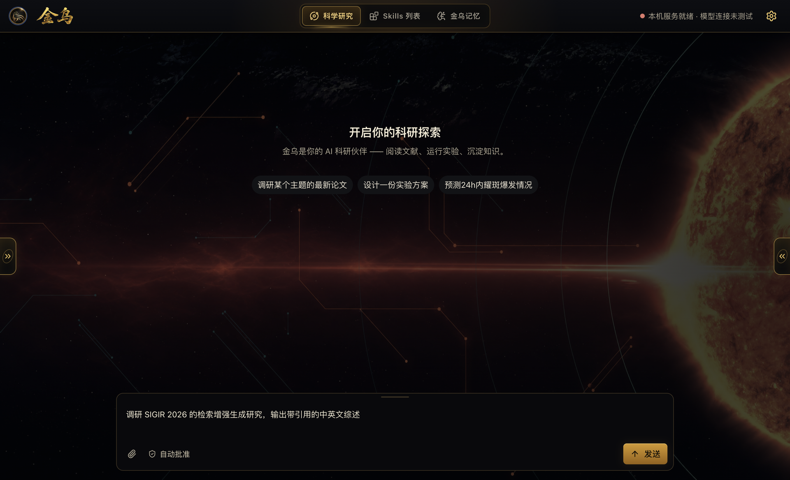

<div align="center">
  
  &nbsp;&nbsp;
  

  <h3>From a research question to verifiable results</h3>

  <p>
    Jinwu (JW) is an end-to-end autonomous research agent.<br>
    It links research planning, literature discovery, code execution, data analysis, experiment verification and report writing into one continuous workflow.
  </p>

  <p>
    <a href="https://github.com/zby0407/Jinwu-agent/actions/workflows/test.yml"></a>
    <a href="https://github.com/zby0407/Jinwu-agent/blob/main/LICENSE"></a>
    
  </p>

  <p>
    <a href="README.zh-CN.md">中文</a> ·
    <a href="#quick-start">Quick start</a> ·
    <a href="#core-capabilities">Core capabilities</a> ·
    <a href="docs/examples/survey-literature/README.md">Examples</a> ·
    <a href="docs/README.md">Documentation</a> ·
    <a href="CONTRIBUTING.md">Contributing</a>
  </p>
</div>

---

## Not just answering questions — advancing research

Give Jinwu a research goal and it will break the work down, call tools, run the analysis and save the results. It keeps evidence at key steps and tracks hypotheses, experiments and context as the research unfolds.

- **Literature review**: discover, screen and read papers in a structured way, then produce a survey with citations.
- **Data analysis**: write and run code to process data, generate figures and verify results.
- **Experimental research**: manage hypotheses and experiments, record the process, review the evidence and iterate on the approach.
- **Writing**: turn the research process into reports, surveys and reproducible artifacts.

## Core capabilities

| Capability | What it does |
| --- | --- |
| **End-to-end research orchestration** | Organizes the whole task around a research goal, from planning and retrieval through execution to verification, writing and delivery. |
| **Specialist sub-agents** | Coordinates dedicated roles for literature, code, data analysis, scientific hypotheses, experiments and evidence review. |
| **Traceable research process** | Manages evidence and counter-evidence, retaining tool calls, task state and artifacts so you get more than a conclusion without support. |
| **Persistent memory and knowledge base** | Preserves research context across sessions and accumulates searchable, source-attributed project knowledge. |
| **Extensible skills and tools** | Install domain skills and connect MCP servers and third-party tools so the agent fits your research workflow. |
| **Flexible model choice** | Works with Claude, GPT, Gemini, Qwen, DeepSeek, Kimi, GLM, Ollama, OpenRouter and custom compatible endpoints. |

## See how it works

The Jinwu desktop app brings scientific research, domain skills and long-term memory into a single window, so you can start a research task without managing a Python or Node.js environment yourself.

<div align="center">
  
  <p><sub>Jinwu desktop: start from a research question, and let the agent plan and execute the work</sub></p>
</div>

**[See the full example and its output →](docs/examples/survey-literature/README.md)**

## Quick start

### Download the desktop app

No need to install Python, Node.js or any other runtime. Pick your platform and download:

| Platform | Installer |
| --- | --- |
| **macOS (Apple Silicon)** | **[Download `.dmg`](https://github.com/zby0407/Jinwu-agent/releases/download/v0.3.5-desktop.1/Jinwu-0.3.5-mac-arm64.dmg)** |
| **Windows (x64)** | **[Download `.exe`](https://github.com/zby0407/Jinwu-agent/releases/download/v0.3.5-desktop.1/Jinwu-0.3.5-win-x64.exe)** |

[See release notes and SHA256 checksums →](https://github.com/zby0407/Jinwu-agent/releases/tag/v0.3.5-desktop.1)

> The current installers are not signed. On macOS, right-click the app and choose "Open" the first time; on Windows, choose "More info → Run anyway" if SmartScreen appears.

### Run from source

Requirements: Python 3.11+, [uv](https://docs.astral.sh/uv/); Node.js 20+ to build the WebUI.

```bash
git clone https://github.com/zby0407/Jinwu-agent.git
cd Jinwu-agent
uv sync
uv run jw onboard
uv run jw
```

### Choose how you work

```bash
jw                         # default TUI
jw --ui cli                # interactive CLI
jw --ui webui              # browser-based WebUI
jw -p "survey this area and produce a cited literature review"  # one-shot task
jw --resume                # resume a session
```

The default config lives in `~/.config/jw/config.yaml`, and runtime data lives in `~/.jw/`. You can also provide model credentials through environment variables; see [`.env.example`](.env.example).

## Three research modes

| Mode | When to use it |
| --- | --- |
| `fast_answer` | Answer factual questions quickly; handle lightweight tasks. |
| `verified_analysis` | Tasks that need tool execution, data analysis and checking of results. |
| `full_research` | Complete research tasks that need planning, retrieval, experiments, evidence review and writing. |

## Docker

```bash
cp .env.example .env
# Set the API key of at least one model provider in .env
docker compose build
docker compose run --rm jw
```

## Documentation and examples

- **[Documentation hub](docs/README.md)**: examples, deployment options and usage guides
- **[Full literature review example](docs/examples/survey-literature/README.md)**: from a topic to a bilingual survey of 68 papers across 10 sections
- **[Project layout and data locations](docs/PROJECT_LAYOUT.md)**: source tree, workspace and runtime artifacts
- **[WebUI guide](webui/README.md)**: what the browser interface does and how to develop it
- **[H1/H2 one-shot reproduction guide](docs/guides/solar-h1-h2-reproduction.md)**: fixed models, inputs and prompts for reproducible runs

## Contributing

Issues, pull requests, new research skills and usage examples are all welcome. Please read the [contributing guide](CONTRIBUTING.md) before you start.

```bash
# Backend checks
uv run ruff check --select F .
uv run ruff format --check jw tests
uv run pytest

# WebUI development
cd webui
npm install
npm run dev
```

## License

Jinwu's original code is licensed under the [Apache License 2.0](LICENSE). The project includes or adapts code from other open-source projects; see [NOTICE](NOTICE) and the [third-party license inventory](THIRD_PARTY_LICENSES.md) for attribution and license details.
