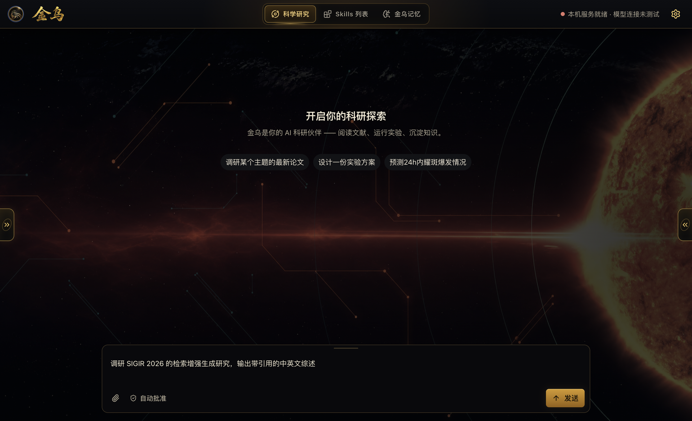

<div align="center">
  
  &nbsp;&nbsp;
  

  <h3>从一个研究问题，到可验证的研究成果</h3>

  <p>
    金乌（JW）是一个端到端自主科研智能体。<br>
    将研究规划、文献检索、代码执行、数据分析、实验验证与报告写作串成一条完整工作流。
  </p>

  <p>
    <a href="https://github.com/zby0407/Jinwu-agent/actions/workflows/test.yml"></a>
    <a href="https://github.com/zby0407/Jinwu-agent/blob/main/LICENSE"></a>
    
  </p>

  <p>
    <a href="README.md">English</a> ·
    <a href="#快速开始">快速开始</a> ·
    <a href="#核心能力">核心能力</a> ·
    <a href="docs/examples/survey-literature/README.md">示例</a> ·
    <a href="docs/README.md">文档</a> ·
    <a href="CONTRIBUTING.md">参与贡献</a>
  </p>
</div>

---

## 不只是回答问题，而是推进研究

给金乌一个研究目标，它会拆解任务、调用工具、执行分析并保存成果；在关键步骤保留证据，在研究过程中持续管理假设、实验和上下文。

- **文献调研**：发现、筛选并结构化阅读论文，生成带引用的综述。
- **数据分析**：编写并运行代码，处理数据、生成图表、验证结果。
- **实验研究**：管理假设与实验，记录过程，审查证据并迭代方案。
- **成果写作**：将研究过程沉淀为报告、综述和可复现的工作产物。

## 核心能力

| 能力 | 说明 |
| --- | --- |
| **端到端科研编排** | 从规划、检索和执行，到验证、写作与交付，围绕研究目标组织完整任务。 |
| **专业子智能体** | 调度文献、代码、数据分析、科学假设、实验与证据审查等专业角色协同工作。 |
| **可追溯的研究过程** | 管理证据与反证，保留工具调用、任务状态和研究成果，减少“只给结论、不知依据”。 |
| **持久记忆与知识库** | 跨会话保留研究上下文，积累可检索、有来源的项目知识。 |
| **可扩展技能与工具** | 安装领域技能，接入 MCP 与第三方工具，让智能体适配你的研究流程。 |
| **灵活的模型选择** | 支持 Claude、GPT、Gemini、Qwen、DeepSeek、Kimi、GLM、Ollama、OpenRouter 及自定义兼容端点。 |

## 看看它如何工作

金乌桌面端将科学研究、领域技能与长期记忆整合在同一窗口中，无需单独管理 Python 或 Node.js 环境，即可直接发起研究任务。

<div align="center">
  
  <p><sub>金乌桌面端：从研究问题开始，让智能体规划并执行科研任务</sub></p>
</div>

**[查看完整示例与生成结果 →](docs/examples/survey-literature/README.md)**

## 快速开始

### 下载桌面版

无需单独安装 Python、Node.js 或其他运行环境，选择你的平台直接下载：

| 平台 | 安装包 |
| --- | --- |
| **macOS（Apple Silicon）** | **[下载 `.dmg`](https://github.com/zby0407/Jinwu-agent/releases/download/v0.3.5-desktop.1/Jinwu-0.3.5-mac-arm64.dmg)** |
| **Windows（x64）** | **[下载 `.exe`](https://github.com/zby0407/Jinwu-agent/releases/download/v0.3.5-desktop.1/Jinwu-0.3.5-win-x64.exe)** |

[查看发布说明与 SHA256 校验和 →](https://github.com/zby0407/Jinwu-agent/releases/tag/v0.3.5-desktop.1)

> 当前安装包尚未签名。macOS 首次打开请右键应用并选择「打开」；Windows 显示 SmartScreen 提示时，请选择「仍要运行」。

### 一行命令安装（CLI / TUI）

macOS 或 Linux：

```bash
curl -LsSf https://raw.githubusercontent.com/zby0407/Jinwu-agent/main/install.sh | sh
```

Windows PowerShell：

```powershell
powershell -ExecutionPolicy Bypass -Command "irm https://raw.githubusercontent.com/zby0407/Jinwu-agent/main/install.ps1 | iex"
```

### 从源码运行

环境要求：Python 3.11+、[uv](https://docs.astral.sh/uv/)；构建 WebUI 需要 Node.js 20+。

```bash
git clone https://github.com/zby0407/Jinwu-agent.git
cd Jinwu-agent
uv sync
uv run jw onboard
uv run jw
```

### 选择你的工作方式

```bash
jw                         # 默认 TUI
jw --ui cli                # 交互式 CLI
jw --ui webui              # 浏览器 WebUI
jw -p "调研这个方向并输出带引用的综述"  # 单次任务
jw --resume                # 恢复会话
```

默认配置保存在 `~/.config/jw/config.yaml`，运行数据保存在 `~/.jw/`。也可以参考 [`.env.example`](.env.example)，通过环境变量提供模型密钥。

## 三种研究模式

| 模式 | 适用场景 |
| --- | --- |
| `fast_answer` | 快速回答事实性问题，处理轻量任务。 |
| `verified_analysis` | 需要工具执行、数据分析和结果核验的任务。 |
| `full_research` | 需要规划、检索、实验、证据审查与成果写作的完整研究任务。 |

## Docker

```bash
cp .env.example .env
# 在 .env 中至少配置一个模型供应商的 API Key
docker compose build
docker compose run --rm jw
```

## 文档与示例

- **[文档中心](docs/README.md)**：示例、部署方案与使用指南
- **[文献综述完整示例](docs/examples/survey-literature/README.md)**：从主题到 68 篇论文、10 个章节的中英文综述
- **[项目目录与数据位置](docs/PROJECT_LAYOUT.md)**：源码、工作区与运行产物说明
- **[WebUI 说明](webui/README.md)**：浏览器界面的功能与开发方式
- **[H1/H2 一次性复现指南](docs/guides/solar-h1-h2-reproduction.md)**：固定模型、输入与提示词的复现流程

## 参与贡献

欢迎提交 Issue、Pull Request，或贡献新的科研技能与使用示例。开始之前请阅读[贡献指南](CONTRIBUTING.md)。

```bash
# 后端检查
uv run ruff check --select F .
uv run ruff format --check jw tests
uv run pytest

# WebUI 开发
cd webui
npm install
npm run dev
```

## License

金乌原创代码采用 [Apache License 2.0](LICENSE)。项目包含或改编了其他开源项目的部分代码，相关版权归属与许可证见 [NOTICE](NOTICE) 和[第三方依赖许可证清单](THIRD_PARTY_LICENSES.md)。
